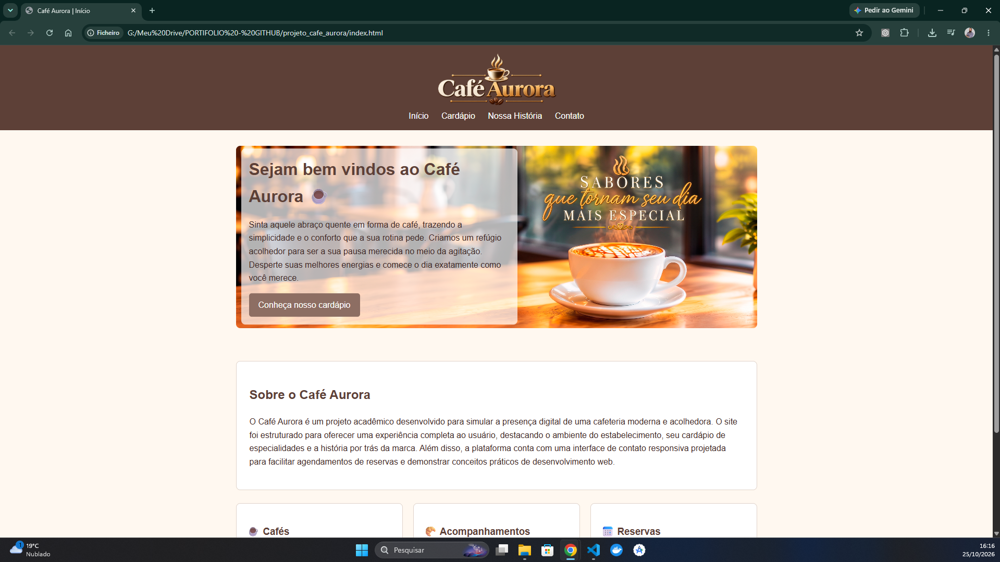
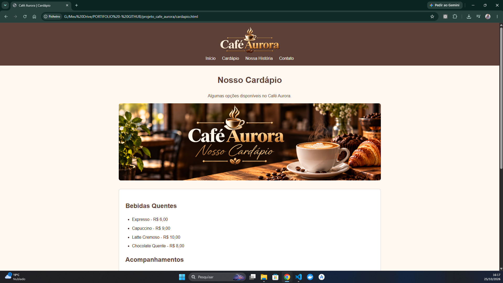
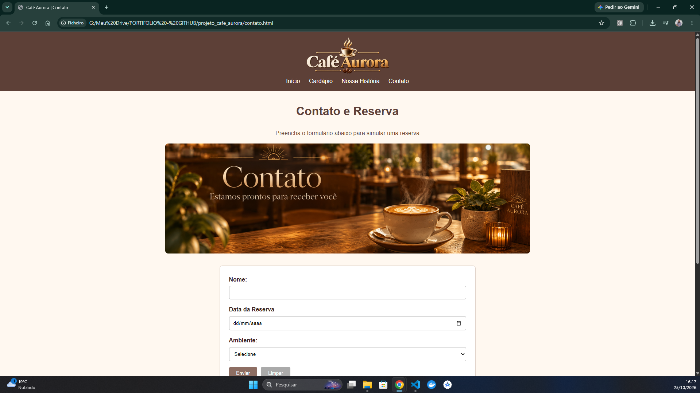

# ☕ Café Aurora

**Meu primeiro projeto publicado no GitHub | HTML5 e CSS3**

O **Café Aurora** é um site fictício de cafeteria que desenvolvi como projeto acadêmico para colocar em prática meus conhecimentos de HTML e CSS. Ele possui quatro páginas: início, cardápio, nossa história e contato.

Esse projeto marca o começo do meu portfólio em tecnologia. 🚀

## 📖 Como surgiu a ideia

Sou estudante de **Engenharia da Computação** e estou entrando no **4º semestre**. Durante os três primeiros semestres, já praticava programação e fazia exercícios, mas preferi focar primeiro em entender a lógica e os fundamentos, para ganhar mais segurança antes de compartilhar projetos no GitHub.

Agora decidi ir além dos exercícios e colocar o aprendizado em prática de forma mais aprofundada: criar um site com várias páginas, organizar os arquivos, trabalhar com imagens, estilos, tabelas, formulários e navegação.

Escolhi o tema de uma cafeteria porque dava para praticar tudo isso em um projeto simples, dentro do meu nível atual de conhecimento. Ainda tenho bastante coisa para aprender, e a ideia é evoluir aos poucos.

## 💻 O que desenvolvi

- 🏠 **Início:** apresentação da cafeteria, imagem de destaque e acesso ao cardápio.
- ☕ **Cardápio:** opções de bebidas e acompanhamentos, com lista e tabela de preços.
- 📖 **Nossa História:** página com uma história fictícia para a cafeteria.
- 📅 **Contato:** informações do estabelecimento e formulário para simular uma reserva.

> **Observação:** a cafeteria é fictícia, e o formulário é apenas uma simulação visual em HTML. Ainda não há um sistema de reservas, envio de dados ou banco de dados.

## 📸 Prints do projeto

### 🏠 Página inicial



### ☕ Cardápio



### 📅 Contato e reserva



## 🛠️ Tecnologias utilizadas

- **HTML5** — estrutura e conteúdo das páginas.
- **CSS3** — cores, fontes, espaçamentos, imagens e organização visual.
- **Git e GitHub** — versionamento e publicação do projeto no meu portfólio.

## 📚 O que pratiquei e aprendi

- Criar e conectar diferentes páginas HTML.
- Organizar o projeto em pastas para CSS e imagens.
- Utilizar tags semânticas, como `header`, `nav`, `main`, `section` e `footer`.
- Montar listas e tabelas com produtos e preços.
- Criar formulários com campos de texto, data e seleção.
- Estilizar componentes utilizando classes CSS.
- Utilizar **Flexbox** e fazer ajustes para telas menores com **media queries**.
- Aprender a registrar e compartilhar a evolução do código no GitHub.

## 📁 Organização do projeto

```text
projeto_cafe_aurora/
│
├── css/
│   └── estilo.css
│
├── imagens/
│   ├── ...                  # Banners, fotos e elementos visuais do site
│   └── prints/
│       ├── print-inicio.png
│       ├── print-cardapio.png
│       └── print-contato.png
│
├── index.html
├── cardapio.html
├── historia.html
├── contato.html
└── README.md
```

## ▶️ Como executar o projeto

1. Baixe o repositório ou faça um clone dele.
2. Mantenha os arquivos e as pastas na estrutura apresentada acima.
3. Abra `index.html` no navegador.

Se preferir, abra a pasta no **Visual Studio Code** e utilize a extensão **Live Server** para visualizar as páginas.

## 🚀 Próximos passos

Conforme eu avançar nos estudos, quero continuar melhorando este projeto e criar outros para o meu portfólio. Algumas melhorias que pretendo explorar são:

- Aprimorar a responsividade para diferentes telas.
- Revisar acessibilidade e organização do código.
- Aprender **JavaScript** para criar interações.
- Estudar, futuramente, como integrar formulários a um **backend** e a um **banco de dados**.

## 🎯 Por que estou compartilhando

Não é um projeto avançado, nem quero apresentá-lo como se fosse. É meu **primeiro passo público**, feito com os conhecimentos que tenho hoje e com a intenção de continuar aprendendo.

Quero usar o GitHub para acompanhar minha evolução, mostrar o que sou capaz de construir e buscar minha primeira oportunidade em tecnologia.

**Em breve, novos projetos por aqui! 🚀**

---

**Desenvolvido por Marcio da Silva**  
🎓 Estudante de Engenharia da Computação | Em transição de carreira para tecnologia

[💻 GitHub](https://github.com/marciosilvadev) · [🔗 LinkedIn](https://www.linkedin.com/in/marciosilvadev)
